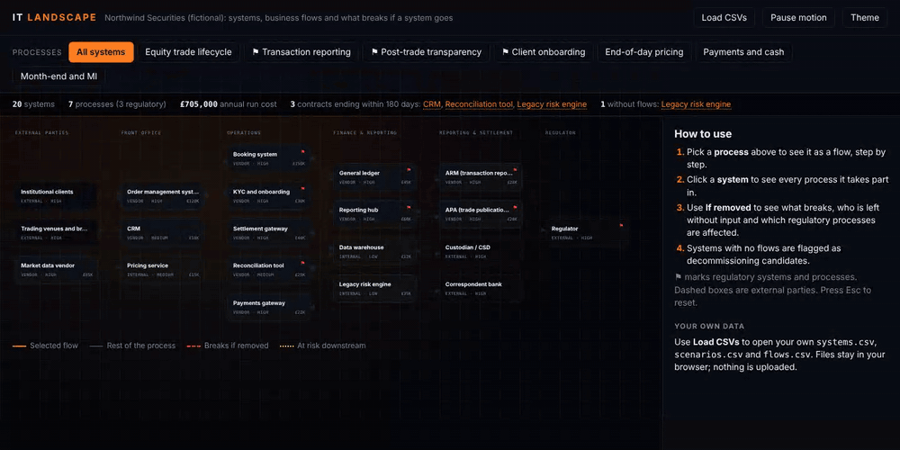
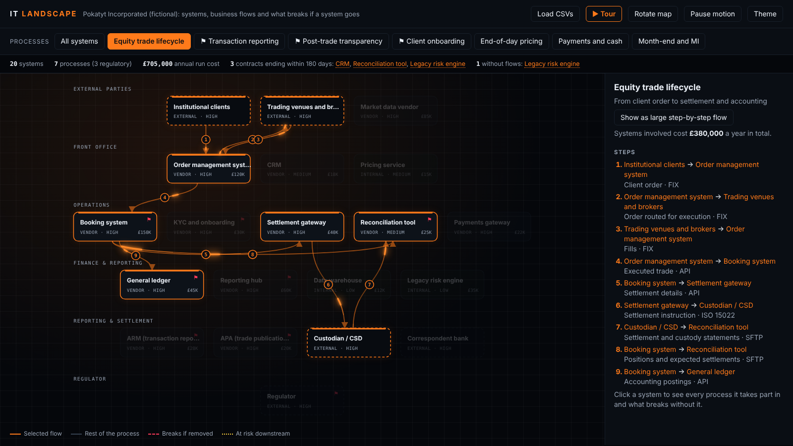
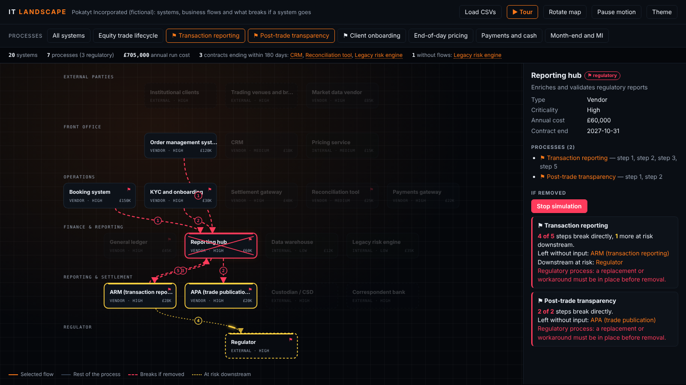

# IT Landscape: systems, flows and "what breaks if we remove it"

An interactive map of a firm's systems and business processes, built as **one HTML file and three CSV files**. No build step, no server-side code, no dependencies.

**Live demo:** https://dzatsepin.github.io/it-landscape/



The demo uses **Pokatyt Incorporated**, a fictional broker with generic systems (OMS, booking, reporting hub, ARM, APA, general ledger and so on). Any resemblance to a real firm's stack is coincidental.

---

## Problem

In most small and mid-sized firms, the IT landscape lives in a diagram that someone drew years ago. It answers "what do we have?" but not the questions leadership actually asks:

- *Which processes does this system support?*
- *If we decommission it, or it goes down, what breaks, and is any of it regulatory?*
- *What are we paying for, and which contracts are coming up for renewal?*
- *Which systems does nothing actually depend on any more?*

Static diagrams go out of date because updating them is a drawing exercise rather than a data change. Answering the questions above means interviewing people every time.

## Approach

Treat the landscape as **data, not a drawing**.

| File | One row per | Key columns |
|---|---|---|
| `data/systems.csv` | system or external party | `id`, `name`, `type`, `layer`, `purpose`, `criticality`, `annual_cost`, `contract_end`, `regulatory` |
| `data/scenarios.csv` | business process | `id`, `name`, `description`, `regulatory` |
| `data/flows.csv` | step in a process | `scenario_id`, `step`, `from`, `to`, `data`, `channel` |

`index.html` reads the CSVs and draws the diagram (layers become columns). Everything else is derived:

- **Guided tour:** *▶ Tour* plays a 30-second walkthrough of the main features. It runs once automatically on a visitor's first visit.
- **Process view:** pick a process to see it light up across the landscape, step by step, with light pulses travelling along each flow. *Show as large step-by-step flow* shows the same process with only its systems, as large blocks.
- **System view:** click a system to see every process it takes part in. Its own steps are highlighted and the rest of each process is shown faded, so you keep the context.
- **If removed:** for each affected process the panel shows how many steps break directly, which systems are left without input, what is at risk downstream, and a warning when the process is regulatory. *Simulate removal* shows the same thing on the diagram.
- **Housekeeping:** total annual run cost, contracts ending within 180 days, and systems with no flows at all, which are flagged as decommissioning candidates together with the potential saving.
- **Your own data:** *Load CSVs* opens your files in the browser. Nothing is uploaded anywhere.
- Vertical map by default (it fits phones and laptops), *Rotate map* for the horizontal view, dark and light themes, a *Pause motion* switch, keyboard navigation (Tab, Enter, Esc).





### Why CSV and plain HTML

- **The data outlives the tool.** CSV opens in Excel, diffs cleanly in Git, and can be exported from a CMDB or a SharePoint list.
- **Changes are reviewable.** Adding a system or a flow is a one-line pull request with an audit trail, not a redrawn Visio.
- **Zero running cost and zero attack surface.** It is a static page that can be hosted on GitHub Pages, SharePoint or a file share.

### How "if removed" is calculated

For a removed system **R** and each process **P** that uses it:

1. **Broken directly:** steps of P where R is the sender or the receiver.
2. **Downstream at risk:** systems reachable from R by following P's flows forwards, and the steps they send.
3. **Left without input:** systems whose *only* incoming flows in P come from R.

This is a first-order dependency model. It tells you where to look; it does not replace a conversation with the system owners.

## Result

- One place to answer *"what does this system do for us, and what happens without it?"* in seconds, during a meeting.
- Decommissioning and renewal discussions start from data: cost, contract end date, dependent processes and regulatory exposure.
- The landscape is kept current as part of normal change management: every new interface is a row in `flows.csv`.

## How to run

**Online:** open the GitHub Pages link above.

**Locally:**

```bash
git clone https://github.com/DZatsepin/it-landscape.git
cd it-landscape
python -m http.server 8000
# open http://localhost:8000
```

Opening `index.html` directly from disk also works, but browsers block it from reading `data/` automatically. Use **Load CSVs** and pick the three files.

**With your own data:** copy the three CSVs, replace the rows, keep the headers. `layer` is a number from 0 (left) upwards; the column names for layers are set in `LAYER_NAMES` at the top of the script. `type` is `External`, `Vendor` or `Internal`. `regulatory` is `Y` or `N`.

> Before you publish a fork with real data, remember that a list of systems, vendors and interfaces is useful reconnaissance for an attacker. Keep real landscapes private.

**Publish on GitHub Pages:** *Settings → Pages → Deploy from a branch → `main` / root*.

## Repository structure

```
it-landscape/
├── index.html          # the whole app: layout, rendering, impact analysis
├── data/
│   ├── systems.csv
│   ├── scenarios.csv
│   └── flows.csv
├── docs/               # screenshots for this README
├── LICENSE
└── README.md
```

## Ideas for next steps

- Export the current view as SVG or PNG for board packs.
- Add `owner` and `rto` columns and show an outage-impact view.
- Generate `flows.csv` from interface monitoring rather than by hand.

## Licence

MIT. See [LICENSE](LICENSE).
